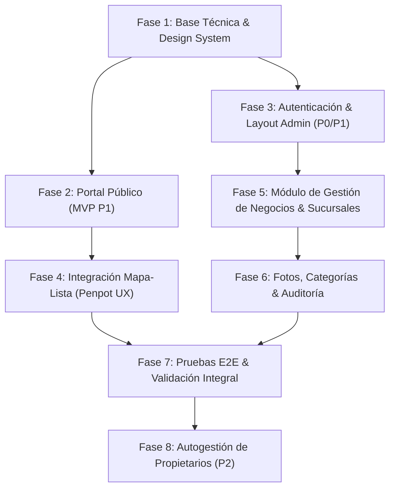

# REQUERIMIENTOS FRONTEND — DIRECTORIO GEO DE NEGOCIOS DE BOLIVIA

> **Versión:** 1.0  
> **Fecha:** 2026-11-19  
> **Stack:** Next.js 16 (App Router), React 19, TypeScript 5, Tailwind CSS 4, Turbopack, pnpm  
> **Prototipo UI de Referencia:** [Penpot Export / GuiaCofre](https://devcastro9.github.io/penpot/)  
> **Contrato Normativo de API:** [REQUERIMIENTOS_API.md](REQUERIMIENTOS_API.md)  
> **Requerimientos de Negocio:** [Funcionalidades_Directorio_Geo_SQL_v1_3.md](Funcionalidades_Directorio_Geo_SQL_v1_3.md)  
> **Reglas Monorepo & Agentes:** [AGENTS.md](AGENTS.md)

---

## 1. OBJETIVO, ALCANCE Y STACK TECNOLÓGICO

### 1.1 Propósito del Documento
El presente documento define la especificación integral de requerimientos funcionales, arquitectura de componentes, diseño de interfaz (UI/UX), interacción y consumo de servicios REST para el **Frontend** del Directorio Geo de Negocios de Bolivia.

La aplicación frontend comprende dos grandes áreas operativas:
1. **Portal Público (Ciudadano / Visitante):** Experiencia de descubrimiento geolocalizado en Bolivia sin registro requerido («Cerca de mí», «Buscar en esta zona», «Abierto ahora», fichas de contacto y navegación asistida), implementada fielmente bajo la arquitectura visual del prototipo en [https://devcastro9.github.io/penpot/](https://devcastro9.github.io/penpot/).
2. **Portal Administrativo y de Autogestión (Backoffice):** Panel seguro con control de acceso por roles (`Admin` y `BusinessOwner`), que permite la administración del catálogo de categorías, alta atómica y ciclo de vida de negocios y sucursales (borrador, publicación, archivo, restauración), configuración horaria y territorial, galería fotográfica, asignación de propietarios y auditoría.

### 1.2 Stack Tecnológico Inamovible
De acuerdo con las directrices normativas de [AGENTS.md](AGENTS.md), el stack no admite modificaciones ni reemplazos de frameworks:

| Componente | Tecnología | Versión / Convención |
| --- | --- | --- |
| **Framework Web** | Next.js (App Router, Turbopack) | `16.4.x` |
| **Biblioteca de UI** | React (Server Components por defecto, React Compiler) | `19.3.x` |
| **Lenguaje** | TypeScript | `^5.x` (strict, typesafe) |
| **Motor de Estilos** | Tailwind CSS v4 con `@tailwindcss/turbopack` | `4.3.x` (variables CSS nativas) |
| **Gestor de Paquetes** | pnpm | `12.16.x` (`packageManager: pnpm@12.16.1`) |
| **Mapas Interactivos** | Mapbox GL JS (`react-map-gl` / `mapbox-gl`) | `v3.x` (renderizado solo en cliente con `ssr: false`) |
| **Iconografía** | Lucide React | `^0.468.x` |
| **Gestión de Peticiones** | Fetch API nativo + TanStack Query / React Hooks tipados | Manejo de caché, concurrencia `ETag` y refresh rotativo |
| **Contenedorización** | Docker Multi-stage con salida `standalone` | Node 22 Alpine |

---

## 2. SISTEMA DE DISEÑO Y GUÍA DE ESTILOS (UI/UX)

La identidad gráfica y patrones visuales adoptan la base del prototipo [GuiaCofre / Penpot](https://devcastro9.github.io/penpot/), optimizados para Tailwind CSS 4 y diseño adaptativo (*mobile-first*).

### 2.1 Paleta de Colores y Tokens Visuales
- **Color Primario / Institucional:** Deep Navy `#142D4E` (cabeceras, barras de navegación, botones principales y acentos de marca).
- **Acento / Interacción:** Brand Blue `#0F4C81` / `#2563EB` (focos interactivos, enlaces, estados seleccionados).
- **Superficies y Fondos:**
  - Fondo general de aplicación: `#F8FAFC` (`slate-50`).
  - Fondo de tarjetas y paneles: `#FFFFFF` (`white`).
  - Fondo de barra lateral y filtros: `#FFFFFF` con borde `slate-200`.
- **Estados Semánticos de Negocio:**
  - **Abierto ahora:** Verde Esmeralda (`bg-emerald-50`, `text-emerald-700`, `border-emerald-200`, dot `#10B981`).
  - **Cerrado:** Rojo / Carmesí (`bg-rose-50`, `text-rose-700`, `border-rose-200`, dot `#F43F5E`).
  - **Horario no verificado / Desconocido:** Ámbar (`bg-amber-50`, `text-amber-700`, `border-amber-200`, dot `#F59E0B`).
  - **Borrador (Draft):** Gris pizarra (`bg-slate-100`, `text-slate-700`).
  - **Publicado (Published):** Azul cian (`bg-sky-50`, `text-sky-700`).
  - **Archivado / Baja lógica (Archived):** Rojo neutralizado (`bg-red-50`, `text-red-700`).

### 2.2 Tipografía
- **Familia principal:** `Inter`, sans-serif (Google Fonts).
- **Pesos:** 400 (regular), 500 (medium), 600 (semibold), 700 (bold), 800 (extrabold).
- **Jerarquía:**
  - Títulos principales (H1 / H2): 20px - 24px, semibold/bold, color `#142D4E`.
  - Títulos de tarjeta (H3): 16px - 18px, semibold, `text-slate-900`.
  - Subtítulos y metadatos: 13px - 14px, regular/medium, `text-slate-500`.
  - Badges, pills y tags: 11px - 12px, semibold, uppercase/tracking-wide.

### 2.3 Patrón de Disposición Responsive (Split View)
El layout responde dinámicamente a tres puntos de quiebre (*breakpoints*):
1. **Desktop (`>= 1024px`):** Esquema tri-panel de ancho completo:
   - **Panel Izquierdo (Filtros):** Ancho fijo de 320px, scroll independiente, colapsable.
   - **Panel Central (Lista de Resultados):** Ancho fluido (aprox. 420px - 480px), scroll vertical infinito/paginado de tarjetas.
   - **Panel Derecho (Mapa Interactivo):** Ocupa el 100% del alto visible restante (`calc(100vh - 64px)`), fijado con Mapbox GL, pills de categorías flotantes superiores y botón de geolocalización.
2. **Tablet (`768px - 1023px`):** Esquema bi-panel:
   - Panel de filtros desplegable mediante *drawer/off-canvas*.
   - División 50% lista y 50% mapa interactivo.
3. **Móvil (`< 768px`):** Esquema de vista unificada:
   - Barra de búsqueda compacta superior.
   - Switcher de vista: botón flotante inferior tipo pill `[Ver Mapa 🗺️ / Ver Lista 📋]`.
   - El mapa cuenta con un *bottom sheet* deslizable hacia arriba con la tarjeta de la sucursal seleccionada.

---

## 3. ARQUITECTURA DE LA APLICACIÓN FRONTEND (NEXT.JS APP ROUTER)

### 3.1 Estructura del Árbol de Rutas
La aplicación divide claramente los dominios público y administrativo usando Route Groups:

```text
frontend/src/
├── app/
│   ├── (public)/                       # Grupo de rutas públicas (Visitante)
│   │   ├── layout.tsx                  # Navbar pública, footer y modal contenedor
│   │   ├── page.tsx                    # Vista principal: Búsqueda, lista y mapa split
│   │   ├── negocio/
│   │   │   └── [slug]/
│   │   │       └── page.tsx            # Ficha pública de negocio y sus sucursales
│   │   ├── sucursal/
│   │   │   └── [branchId]/
│   │   │       └── page.tsx            # Ficha pública individual de sucursal
│   │   ├── auth/
│   │   │   ├── login/
│   │   │   │   └── page.tsx            # Inicio de sesión (Admin y Propietarios)
│   │   │   └── register/
│   │   │       └── page.tsx            # Registro público de propietarios (P2)
│   ├── (admin)/                        # Grupo de rutas protegidas (Backoffice)
│   │   └── admin/
│   │       ├── layout.tsx              # Shell administrativo: Sidebar + Header de usuario
│   │       ├── page.tsx                # Dashboard general con métricas operativas
│   │       ├── negocios/
│   │       │   ├── page.tsx            # Bandeja de negocios gestionables
│   │       │   ├── nuevo/
│   │       │   │   └── page.tsx        # Asistente de alta atómica (Negocio + primera sucursal)
│   │       │   └── [id]/
│   │       │       └── page.tsx        # Ficha editable de negocio y lista de sucursales
│   │       ├── sucursales/
│   │       │   └── [branchId]/
│   │       │       └── page.tsx        # Editor completo de sucursal (mapa, horarios, fotos)
│   │       ├── categorias/             # Solo rol Admin
│   │       │   └── page.tsx            # Catálogo administrable de categorías
│   │       ├── propietarios/           # Solo rol Admin (P2)
│   │       │   └── page.tsx            # Gestión de asociaciones y verificación de propietarios
│   │       ├── auditoria/              # Solo rol Admin
│   │       │   └── page.tsx            # Registro y trazabilidad de mutaciones
│   │       └── salud/                  # Solo rol Admin
│   │           └── page.tsx            # Diagnóstico en tiempo real (/health/ready)
│   ├── api/                            # Next.js Route Handlers (BFF o proxy opcional si aplica)
│   ├── favicon.ico
│   ├── globals.css                     # Tailwind CSS v4 variables y directivas
│   └── layout.tsx                      # Root Layout (Fuentes, metadata, ToastProvider)
├── components/
│   ├── public/                         # Componentes del portal público
│   │   ├── Navbar.tsx                  # Barra superior de navegación y accesos
│   │   ├── FilterSidebar.tsx           # Panel de filtros facetados
│   │   ├── BranchList.tsx              # Feed de tarjetas de sucursales
│   │   ├── BranchCard.tsx              # Tarjeta individual de sucursal
│   │   ├── InteractiveMap.tsx          # Componente Mapbox GL (Client Component)
│   │   ├── MapCategoryPills.tsx        # Filtros rápidos flotantes sobre el mapa
│   │   ├── MapBranchPopup.tsx          # Popup informativo del marcador en mapa
│   │   ├── BranchDetailModal.tsx       # Modal o vista de detalle comercial
│   │   └── DemoAboutModal.tsx          # Diálogo informativo "Sobre esta plataforma"
│   ├── admin/                          # Componentes del portal administrativo
│   │   ├── AdminSidebar.tsx            # Barra lateral de navegación con RBAC
│   │   ├── AdminHeader.tsx             # Header de sesión con perfil y cierre de sesión
│   │   ├── BusinessForm.tsx            # Formulario de negocio con soporte ETag
│   │   ├── BranchLocationPicker.tsx    # Selector de ubicación en mapa con validación espacial
│   │   ├── WeeklyHoursEditor.tsx       # Editor de grilla horaria semanal y turnos nocturnos
│   │   ├── DateOverridesEditor.tsx     # Editor de excepciones y festivos
│   │   ├── PhotoGalleryManager.tsx     # Gestor de subida multipart, orden y portada
│   │   └── PublicationStatusBadge.tsx  # Indicador de estado de publicación
│   └── ui/                             # Componentes base reutilizables (Design System)
│       ├── Button.tsx
│       ├── Input.tsx
│       ├── Select.tsx
│       ├── Modal.tsx
│       ├── Toast.tsx
│       ├── Skeleton.tsx
│       └── Badge.tsx
├── hooks/
│   ├── useAuth.ts                      # Hook de sesión, login, logout y auto-refresh
│   ├── useBranchesSearch.ts            # Hook de búsqueda y sincronización mapa-lista
│   ├── useCatalogs.ts                  # Hook de catálogos y jerarquía territorial
│   └── useFavorites.ts                 # Hook de gestión local de favoritos
├── lib/
│   ├── api/
│   │   ├── client.ts                   # Fetch wrapper con inyección Bearer y ETag
│   │   ├── auth.ts                     # Funciones de login, refresh rotativo y logout
│   │   └── types.ts                    # DTOs fuertemente tipados reflejando REQUERIMIENTOS_API.md
│   └── utils/
│       ├── formatters.ts               # Formato de moneda BOB, teléfonos E.164 y distancias
│       └── coordinates.ts              # Conversión y validación de GeoJSON [lng, lat]
└── types/                              # Definiciones globales de TypeScript
```

---

## 4. REQUERIMIENTOS FUNCIONALES — PORTAL PÚBLICO (CIUDADANO)

Basado estrictamente en la experiencia de [https://devcastro9.github.io/penpot/](https://devcastro9.github.io/penpot/) y las especificaciones F01 a F07 de [Funcionalidades_Directorio_Geo_SQL_v1_3.md](Funcionalidades_Directorio_Geo_SQL_v1_3.md):

### RF-PUB-01: Header y Navegación Superior
- **Logotipo y Nombre de Marca:** «Directorio Geo» / «GuiaCofre» con enlace de retorno al inicio (`/`).
- **Botón "Iniciar sesión":** Abre el modal o redirige a `/auth/login`. Si el usuario ya está autenticado, muestra su nombre y enlace directo al Portal Administrativo (`/admin`).
- **Botón "Registrarse":** Enlace a `/auth/register` (disponible en fase P2 para propietarios; oculto o deshabilitado en P1).
- **Selector "Mostrar solo favoritos":** Botón tipo toggle con icono de corazón que filtra instantáneamente la lista central para mostrar solo las sucursales guardadas en el dispositivo local.
- **Menú contextual ("Hamburguesa"):** Despliega opciones secundarias:
  - «Reiniciar exploración»: Limpia todos los filtros y restablece el zoom inicial.
  - «Sobre esta plataforma»: Abre un modal informativo con la descripción del directorio, propósito y alcance.

### RF-PUB-02: Barra Lateral de Filtros Facetados
- **Buscador de texto (`q`):** Campo con placeholder `Negocio, categoría o zona...`, búsqueda insensible a mayúsculas y acentos (`pg_trgm`). Dispara la consulta tras debounce de 350ms o al presionar Enter.
- **Botón "Limpiar todo":** Restablece todos los parámetros a su estado por defecto.
- **Filtro de Ciudad / Región (Territorio):**
  - Selector jerárquico en cascada: Departamento > Municipio > Zona/Barrio opcional (consumiendo `GET /api/v1/territories`).
  - No inventa subdivisiones cuando no existan en la base de datos oficial.
- **Filtro de Categorías y Subcategorías:**
  - Selector de Categoría Raíz y Subcategoría dependiente (consumiendo `GET /api/v1/categories`).
- **Filtro de Disponibilidad ("Abierto ahora"):**
  - Switch o checkbox interactivo (`openNow=true|false`).
  - Solo incluye negocios cuyo estado de atención haya sido evaluado como `true` por el motor de horarios del backend (respetando la zona horaria `America/La_Paz`).
- **Filtro de Nivel de Precio (`priceLevel`):**
  - Selector de rango de presupuesto orientativo: Económico (`$`), Medio (`$$`), Alto (`$$$`), Muy Alto (`$$$$`).
- **Ordenamiento:**
  - Opciones: Por cercanía (cuando existe geolocalización o centro activo) o alfabético por nombre comercial.

### RF-PUB-03: Feed de Tarjetas de Sucursal (Lista Central)
- **Barra de estado superior:**
  - Contador de resultados encontrados (ejemplo: `24 sucursales encontradas`).
  - Chips / Pills de filtros activos con botón `✕` para remover cada filtro individualmente.
- **Estructura de la Tarjeta (`BranchCard`):**
  - **Imagen de Portada:** Cargada desde `/api/v1/photos/{coverPhotoId}` o placeholder temático en caso de ausencia. Relación de aspecto 16:9 con efecto hover.
  - **Identificación:** Nombre comercial del negocio (`tradeName`) en negrita, seguido del nombre de la sucursal (`name`, ej. "Centro", "Calacoto").
  - **Badges de Categoría:** Pill de categoría y subcategoría en tonos slate/indigo suaves.
  - **Indicador de Horario en Vivo:** Badge dinámico:
    - `● Abierto`: Verde esmeralda.
    - `● Cerrado`: Rojo.
    - `● Horario no verificado`: Ámbar (cuando `hoursKnown=false` o no hay información concluyente).
  - **Ubicación y Distancia:** Municipio y zona (ejemplo: `Sucre · Zona Central`), distancia calculada en línea directa (ejemplo: `1.4 km`) cuando la geolocalización está activa.
  - **Nivel de Precio:** Indicador visual (`$`, `$$`, etc.).
  - **Botón de Favorito:** Icono de corazón interactivo para guardar o remover de favoritos en `localStorage`.
  - **Acciones Rápidas Directas:**
    - Botón **Llamar:** Enlace `tel:+591XXXXXXXX` (solo visible si existe contacto telefónico).
    - Botón **WhatsApp:** Enlace directo a `https://wa.me/591XXXXXXXX` con mensaje predeterminado.
    - Clic general en la tarjeta: Centra el mapa en las coordenadas de la sucursal, activa su pin y abre el popup informativo.

### RF-PUB-04: Mapa Interactivo (Mapbox GL JS)
- **Renderizado del Mapa:** Integración con `react-map-gl` utilizando el estilo configurado por entorno (`NEXT_PUBLIC_MAPBOX_TOKEN`). Carga aislada en cliente con `ssr: false`.
- **Filtros Rápidos en Pills Flotantes:**
  - Barra horizontal de pills superpuesta en la parte superior del mapa («Todas», «Salud», «Gastronomía», «Farmacias», etc.) para conmutar categorías principales con un solo clic.
- **Control "Usar mi ubicación":**
  - Botón flotante que invoca `navigator.geolocation.getCurrentPosition`.
  - Si se concede el permiso: centra el mapa en las coordenadas del visitante, establece el radio de búsqueda (por defecto 10 km) y ordena los resultados por distancia en metros (`distanceM`).
  - Si se deniega el permiso: muestra un toast explicativo y permite seleccionar manualmente un municipio.
- **Botón Dinámico "Buscar en esta zona":**
  - Al arrastrar o hacer zoom en el mapa, aparece un botón flotante centrado superior «Buscar en esta zona».
  - Al pulsarlo, sustituye la búsqueda radial por una consulta con `bbox=minLng,minLat,maxLng,maxLat`, reinicia la paginación a la página 1 y refresca tanto el mapa como la lista de tarjetas.
- **Marcadores Interactivos (Pins):**
  - Pines georreferenciados en formato GeoJSON (`[longitud, latitud]`).
  - Iconografía diferenciada por categoría con animación de resalte al seleccionarse en la lista.
- **Popup de Sucursal en Mapa:**
  - Al hacer clic en un pin, se despliega una tarjeta emergente que muestra: nombre comercial, sucursal, categoría, zona, indicador de apertura, botón directo de WhatsApp y botón "Ver detalles".

### RF-PUB-05: Ficha Detallada de Sucursal y Negocio
- Accesible mediante modal superpuesto o ruta pública directa (`/negocio/[slug]` o `/sucursal/[branchId]`).
- **Galería Multimedia:** Visor de fotos con carrusel/lightbox de imágenes oficiales.
- **Horarios de Atención Semanales:**
  - Desglose por día (0 = Domingo a 6 = Sábado), indicando turnos múltiples y cruces de medianoche.
  - Sección de excepciones y feriados vigentes en la ventana de 365 días.
- **Canales de Contacto Verificados:**
  - Teléfono (`tel:`), WhatsApp (`wa.me`), Correo electrónico (`mailto:`), Enlaces a Sitio Web, Facebook e Instagram.
- **Servicios, Características y Medios de Pago:** Listado de atributos comerciales en formato de tags o pills legibles.
- **Botón "Cómo llegar" (Navegación Asistida):**
  - Abre externamente la URL canónica de Google Maps: `https://www.google.com/maps/dir/?api=1&destination=lat,lng`.
  - No realiza cálculo propio de rutas ni envía información privada del visitante.

---

## 5. REQUERIMIENTOS FUNCIONALES — PORTAL ADMINISTRATIVO Y AUTOGESTIÓN

Diseñado para satisfacer las operaciones de gestión descritas en [REQUERIMIENTOS_API.md](REQUERIMIENTOS_API.md) y los requerimientos F08 a F14 de [Funcionalidades_Directorio_Geo_SQL_v1_3.md](Funcionalidades_Directorio_Geo_SQL_v1_3.md):

### RF-ADM-01: Autenticación, Sesión y Control de Acceso por Roles (RBAC)
- **Inicio de Sesión (`POST /api/v1/auth/login`):**
  - Formulario con campos `email` y `password`.
  - Al autenticar con éxito: almacena el `accessToken` (JWT de 15 min de vigencia) estrictamente en memoria (React Context o store volátil).
  - La cookie segura `dg_refresh` (HttpOnly, SameSite=Strict, Path=/api/v1/auth) es manipulada automáticamente por el navegador.
- **Renovación Transparente de Token (`POST /api/v1/auth/refresh`):**
  - Interceptor HTTP que captura errores 401 y serializa la llamada a refresh para evitar carreras.
  - Si la cookie expira o se invalida, revoca la sesión y redirige a `/auth/login`.
- **Cierre de Sesión (`POST /api/v1/auth/logout`):**
  - Limpia el token en memoria, invoca la revocación de la cookie y redirige a la página pública.
- **Control de Acceso por Rol:**
  - `Admin`: Acceso total (Gestión de negocios, publicación/retiro, categorías, propietarios, auditoría, salud).
  - `BusinessOwner`: Acceso restringido únicamente a los negocios y sucursales donde figure como propietario asociado vigente. No puede publicar directamente, restaurar negocios eliminados ni acceder a categorías o auditoría.

### RF-ADM-02: Shell Administrativo y Dashboard
- **Sidebar de Navegación Responsiva:**
  - Opciones contextuales según el rol activo.
  - Botón de colapso rápido para optimizar el espacio de trabajo en tablas y mapas.
- **Header Administrativo:**
  - Muestra nombre del usuario, rol asignado, botón de cambio de tema/contraste y menú de perfil/cierre de sesión.
- **Dashboard Principal (`/admin`):**
  - Tarjetas de resumen métrico: Total de negocios gestionados, negocios en borrador, publicados y archivados.
  - Accesos directos a «Crear nuevo negocio» y «Ver mapa público».

### RF-ADM-03: Módulo de Gestión de Negocios (`/admin/negocios`)
- **Tabla de Negocios (`GET /api/v1/management/businesses`):**
  - Filtro por texto en `tradeName` o `slug`.
  - Filtro por estado de publicación: `draft`, `published`, `archived`.
  - Switch para incluir dados de baja lógica (`deleted=true`, solo visible para `Admin`).
  - Columnas: Nombre comercial, Slug, Estado comercial, Estado de publicación, Nro. de sucursales activas, Fecha de última modificación y acciones.
- **Asistente de Alta Atómica de Negocio (`POST /api/v1/management/businesses`):**
  - Formulario guiado por pasos (Wizard) para crear atómicamente el negocio en estado borrador (`draft`) junto con su primera sucursal principal (`isPrimary=true`).
  - Paso 1: Datos del negocio (Nombre comercial, descripción, nivel de precio orientativo; campos `legalName` y `taxId` exclusivos para `Admin`).
  - Paso 2: Datos de la sucursal (Nombre de sucursal, dirección, localización en mapa, municipio, categorías y contactos).
- **Edición de Negocio (`PUT /api/v1/management/businesses/{id}`):**
  - Carga el negocio con su cabecera `ETag` (ejemplo: `"business:{uuid}:v{revision}"`).
  - Inyecta obligatoriamente la cabecera `If-Match` en el guardado para garantizar concurrencia optimista.
  - Si el backend responde `412 Precondition Failed` (versión obsoleta), la UI alerta al usuario de cambios concurrentes y solicita recargar los datos.
- **Flujo de Publicación / Retiro (`PUT /api/v1/management/businesses/{id}/publication`):**
  - Exclusivo para rol `Admin`.
  - Modal de confirmación para cambiar estado entre `draft` y `published`.
  - Valida en cliente y muestra errores si el negocio no cumple los requisitos mínimos de publicación (descripción no vacía, al menos una sucursal visible con dirección, punto municipal válido, al menos una categoría y un contacto).
- **Baja Lógica y Restauración:**
  - **Baja (`DELETE /api/v1/management/businesses/{id}`):** Pasa el negocio a `archived` y oculta sus sucursales.
  - **Restauración (`POST /api/v1/management/businesses/{id}/restore`):** Solo `Admin`. Despliega un diálogo que exige seleccionar explícitamente cuáles sucursales se recuperarán junto con el negocio, restaurándose en estado `draft`.

### RF-ADM-04: Módulo de Gestión de Sucursales
- **Selector de Ubicación Geográfica en Mapa:**
  - Componente de mapa interactivo donde el usuario puede arrastrar un pin o hacer clic para fijar la ubicación exacta `[longitud, latitud]`.
  - Valida visualmente que el punto se encuentre dentro del polígono del municipio seleccionado en Bolivia.
- **Formulario Integral de Sucursal:**
  - Datos generales: Nombre de sucursal (ej. "Sucursal Sopocachi"), dirección física descriptiva.
  - Jerarquía territorial: Selectores dependientes de Departamento > Municipio > Zona.
  - Selectores múltiples para categorización: Categorías (máx. 10), Servicios (máx. 30), Características (máx. 30) y Métodos de pago (máx. 30).
  - Switch de Sucursal Principal (`isPrimary`): Al marcar una nueva sucursal como principal, la anterior se desmarca atómicamente.
- **Editor de Horarios Semanales (`openingHours`):**
  - Switch general «Horario de atención conocido» (`hoursKnown`).
  - Tabla de 7 días (0 = Domingo a 6 = Sábado) con soporte de turnos múltiples por día (máx. 28 turnos semanales).
  - Soporte explícito de turnos nocturnos con cruce de medianoche (ejemplo: `20:00` a `02:00`).
  - Validación de intervalos sin solapamientos.
- **Editor de Excepciones y Feriados (`hourOverrides`):**
  - Permite declarar fechas específicas como cerradas o con horario especial en la ventana válida `ayer .. hoy + 365 días`.

### RF-ADM-05: Módulo de Galería Multimedia de Fotos
- **Subida de Imágenes (`POST /api/v1/management/branches/{id}/photos`):**
  - Soporte de subida *multipart/form-data* para archivos individuales JPEG, PNG y WebP (hasta 5 MiB).
  - Campo opcional de texto alternativo (`altText` hasta 300 caracteres).
  - Límite de hasta 20 fotos activas por sucursal.
- **Gestión de la Galería:**
  - Reordenamiento visual tipo drag-and-drop o flechas de prioridad que actualiza el `sortOrder`.
  - Asignación de foto principal de portada (`isPrimary=true`).
  - Eliminación lógica con confirmación.
- **Previsualización Privada de Borradores:**
  - Para negocios no publicados, las fotos se consumen mediante petición autenticada con `Bearer` a `/api/v1/photos/{id}`, creando URLs de objeto local con `URL.createObjectURL(blob)` y liberándolas al desmontar el componente.

### RF-ADM-06: Módulo de Categorías (Solo Rol Admin)
- **Vista de Catálogo (`GET /api/v1/categories`):**
  - Visualización en árbol jerárquico y tabla paginada.
  - Filtro por texto y filtro por categoría raíz (`rootOnly`).
- **Creación y Edición (`POST` y `PUT /api/v1/categories`):**
  - Campos: Código único (`code`, 3..50 car.), Nombre (`name`, 1..100 car.), Descripción opcional, Categoría padre (`parentId`) y Orden de visualización (`sortOrder`).
- **Desactivación y Eliminación:**
  - Desactivación lógica (`isActive: false`).
  - Soft-delete con control de integridad: la UI previene y notifica si la categoría tiene hijas activas antes de permitir su eliminación.

### RF-ADM-07: Módulo de Propietarios y Asociaciones (Solo Admin - P2)
- **Gestión de Titularidad (`/admin/propietarios`):**
  - Permite asociar a un usuario registrado como propietario de un negocio mediante su email normalizado.
  - Registro obligatorio del método de verificación comercial: `business_contact` (contacto telefónico/comercial) o `in_person` (verificación presencial).
  - Listado de propietarios asociados vigentes y botón de revocación inmediata de privilegios (`DELETE /api/v1/admin/businesses/{id}/owners/{userId}`).

### RF-ADM-08: Trazabilidad y Diagnóstico del Sistema (Solo Admin)
- **Auditoría (`GET /api/v1/audit`):**
  - Tabla de consulta de eventos de inserción (`I`), actualización (`U`) y baja (`D`).
  - Filtros por entidad (`business`, `branch`, `branch_photo`, etc.), ID de recurso y rango de fechas.
- **Semáforo de Salud (`GET /api/v1/health/ready`):**
  - Indicador visual del estado de la base de datos, extensiones PostGIS y API REST.

---

## 6. MATRIZ DE INTEGRACIÓN CON ENDPOINTS REST (`REQUERIMIENTOS_API.md`)

Mapeo detallado de cada componente y pantalla con las operaciones del contrato canónico:

| ID | Método | Endpoint Relativo | Rol Requerido | Pantalla / Componente Frontend | Descripción / Payload |
| --- | --- | --- | --- | --- | --- |
| **01b** | `GET` | `/categories` | Público | `FilterSidebar`, `MapCategoryPills`, `AdminCategorias` | Lista paginada de categorías activas para filtros y árbol administrativo. |
| **01c** | `GET` | `/categories/{id}` | Público | `AdminCategorias` | Detalle individual de categoría para edición. |
| **01d** | `POST` | `/categories` | `Admin` | Modal Crear Categoría | Creación de nueva categoría activa. Body: `CreateCategoryRequest`. |
| **--** | `PUT` | `/categories/{id}` | `Admin` | Modal Editar Categoría | Modificación de categoría. Body: `UpdateCategoryRequest`. |
| **--** | `DELETE`| `/categories/{id}` | `Admin` | `AdminCategorias` | Baja lógica de categoría (rechaza si tiene hijas activas). |
| **02** | `GET` | `/territories` | Público | `FilterSidebar`, `BranchLocationPicker` | Consulta en cascada de Departamentos, Municipios y Zonas. |
| **03** | `GET` | `/branches` | Público | `BranchList`, `InteractiveMap` | Búsqueda por texto (`q`), categoría, territorio, radio (`lat,lng,radiusM`) o caja (`bbox`), con formato JSON o GeoJSON. |
| **04** | `GET` | `/businesses/{slug}` | Público | `/negocio/[slug]/page.tsx` | Ficha pública completa del negocio y sus sucursales visibles. |
| **05** | `GET` | `/branches/{branchId}` | Público | `/sucursal/[branchId]/page.tsx`, `BranchDetailModal` | Ficha pública detallada de sucursal con horarios, excepciones y contactos. |
| **06** | `GET` | `/photos/{photoId}` | Público / `M` | `BranchCard`, `PhotoGallery`, `BranchDetailModal` | Entrega de bytes binarios (JPEG, PNG, WebP) servidos con `no-store`. |
| **07** | `POST` | `/auth/login` | Público | `/auth/login/page.tsx` | Inicio de sesión. Body: `{email, password}`. Retorna `AuthSession` y setea cookie `dg_refresh`. |
| **08** | `POST` | `/auth/refresh` | Público | `useAuth` / Interceptor HTTP | Renovación silenciosa de token mediante cookie rotativa. |
| **09** | `POST` | `/auth/logout` | Público | `AdminHeader`, `Navbar` | Cierre de sesión y revocación de familia de tokens. |
| **10** | `GET` | `/auth/me` | Sesión | `useAuth`, `AdminSidebar` | Obtiene identidad, nombre y roles del usuario activo. |
| **11** | `GET` | `/management/businesses` | `Admin`/`Owner` | `/admin/negocios/page.tsx` | Bandeja paginada de negocios gestionables con filtro de publicación y deleted. |
| **12** | `POST` | `/management/businesses` | `Admin`/`Owner` | `/admin/negocios/nuevo/page.tsx` | Alta atómica de negocio borrador + primera sucursal principal. |
| **13** | `GET` | `/management/businesses/{id}` | `Admin`/`Owner` | `/admin/negocios/[id]/page.tsx` | Obtiene el negocio gestionable completo, incluyendo `ETag` y revisión. |
| **14** | `PUT` | `/management/businesses/{id}` | `Admin`/`Owner` | `BusinessForm` | Modificación de datos de negocio. Requiere cabecera `If-Match`. |
| **15** | `PUT` | `/management/businesses/{id}/publication`| `Admin` | Botón Publicar/Retirar | Cambia estado entre `draft` y `published`. Requiere `If-Match`. |
| **16** | `DELETE`| `/management/businesses/{id}` | `Admin` | `/admin/negocios/page.tsx` | Baja lógica de negocio (pasa a `archived`). Requiere `If-Match`. |
| **17** | `POST` | `/management/businesses/{id}/restore` | `Admin` | Modal Restaurar Negocio | Recupera negocio eliminado con selección explícita de sucursales. |
| **18** | `POST` | `/management/businesses/{id}/branches` | `Admin`/`Owner` | Modal Nueva Sucursal | Alta de sucursal adicional para un negocio existente. |
| **19** | `PUT` | `/management/branches/{branchId}` | `Admin`/`Owner` | `/admin/sucursales/[id]/page.tsx` | Reemplazo completo de sucursal, horarios y contactos. Requiere `If-Match`. |
| **20** | `DELETE`| `/management/branches/{branchId}` | `Admin`/`Owner` | Lista de sucursales | Baja lógica de sucursal (impide eliminar la última sucursal activa). |
| **21** | `POST` | `/management/branches/{branchId}/restore` | `Admin` | Lista de sucursales | Restaura una sucursal dada de baja en un negocio vigente. |
| **22** | `POST` | `/management/branches/{branchId}/photos` | `Admin`/`Owner` | `PhotoGalleryManager` | Carga multipart de imagen (máx. 5 MiB). Retorna `ManagedBusiness`. |
| **23** | `PUT` | `/management/photos/{photoId}` | `Admin`/`Owner` | `PhotoGalleryManager` | Edita texto alternativo, orden o designa foto principal. Requiere `If-Match`. |
| **24** | `DELETE`| `/management/photos/{photoId}` | `Admin`/`Owner` | `PhotoGalleryManager` | Baja lógica de foto. Requiere `If-Match`. |
| **25** | `GET` | `/audit` | `Admin` | `/admin/auditoria/page.tsx` | Registro histórico de cambios por entidad, fecha y actor. |
| **26** | `GET` | `/health` | Público | Monitoreo | Comprobación de proceso backend activo. |
| **27** | `GET` | `/health/ready` | Público / `Admin` | `/admin/salud/page.tsx` | Comprobación de disponibilidad de base de datos y esquema. |
| **28** | `POST` | `/auth/register` | Público (P2) | `/auth/register/page.tsx` | Registro público de propietarios (crea cuenta con rol `User`). |
| **29** | `GET` | `/admin/businesses/{id}/owners` | `Admin` (P2) | `/admin/propietarios/page.tsx` | Consulta lista de propietarios asociados a un negocio. |
| **30** | `PUT` | `/admin/businesses/{id}/owners` | `Admin` (P2) | Modal Asociar Propietario | Asocia propietario verificado por email. Requiere `If-Match`. |
| **31** | `DELETE`| `/admin/businesses/{id}/owners/{userId}`| `Admin` (P2) | Lista de propietarios | Revoca la asociación de un propietario con el negocio. Requiere `If-Match`. |

---

## 7. REQUERIMIENTOS NO FUNCIONALES Y CRITERIOS DE ACEPTACIÓN

### 7.1 Seguridad y Gestión de Credenciales
- **Almacenamiento de Tokens:** El `accessToken` JWT NUNCA se persiste en `localStorage`, `sessionStorage` ni cookies accesibles por JavaScript. Se almacena exclusivamente en memoria durante el ciclo de vida de la aplicación.
- **Cookies HttpOnly:** La renovación de sesión se basa exclusivamente en la cookie `dg_refresh` enviada con `credentials: "include"`, configurada como `HttpOnly`, `Secure` (en producción) y `SameSite=Strict`.
- **Protección CSRF:** Toda llamada mutante (`POST`, `PUT`, `DELETE`) y peticiones de autenticación deben incluir la cabecera `Origin` validada por la API.
- **Sanitización de Datos:** Los campos de texto libre introducidos por el usuario se normalizan y renderizan sin evaluación de HTML crudo para prevenir ataques de Cross-Site Scripting (XSS).

### 7.2 Concurrencia Optimista (ETag / If-Match)
- Cada consulta de detalle en el portal administrativo (`GET /management/businesses/{id}`) extrae la cabecera de respuesta `ETag` (ejemplo: `"business:{uuid}:v{revision}"`).
- Toda mutación posterior sobre el negocio, sus sucursales, horarios, fotos o propietarios debe inyectar el valor exacto del `ETag` en la cabecera de petición `If-Match`.
- Si el servidor retorna `412 Precondition Failed`, la interfaz de usuario debe capturar el error y mostrar un aviso modal indicando que otro usuario modificó el registro, ofreciendo un botón para recargar la información sin perder los datos editados localmente.

### 7.3 Manejo de Errores Estándar (RFC 7807 ProblemDetails)
- Las respuestas de error del backend con `application/problem+json` deben ser procesadas de manera homogénea:
  - Los errores de validación (`400 validation`) con el diccionario `errors: { [field: string]: string[] }` deben mapearse directamente a los mensajes de error debajo de cada input correspondiente en el formulario.
  - Los errores de conflicto (`409 conflict`), precondición (`428 precondition_required`, `412 stale_version`) o permisos (`401`, `403`) deben disparar notificaciones accesibles tipo Toast o diálogos modales explicativos en español.

### 7.4 Rendimiento y Optimización Web
- **Core Web Vitals:**
  - Largest Contentful Paint (LCP) `< 2.5s` en conexiones 4G estándar.
  - Interaction to Next Paint (INP) `< 200ms`.
  - Cumulative Layout Shift (CLS) `< 0.1` (dimensiones fijas reservadas para el mapa y contenedores de fotos).
- **Aislamiento de Mapbox:** El componente de mapa interactivo debe cargarse de manera dinámica con `ssr: false` para evitar discrepancias de hidratación o errores de ejecución en el servidor Next.js.
- **Optimización de Fotos:** Utilización de Next.js Image o etiquetas seguras con lazy loading y decodificación asíncrona para la entrega de imágenes binarias BYTEA desde `/api/v1/photos/{id}`.

### 7.5 Accesibilidad (a11y) y Experiencia de Usuario
- Cumplimiento de pautas **WCAG 2.1 Nivel AA**.
- Navegación completa por teclado en formularios, filtros facetados y modales (foco visible y atrapamiento de foco en diálogos abiertos).
- Etiquetas semánticas y atributos `aria-label`, `aria-expanded` y `role` en controles interactivos, botones de filtrado y marcadores del mapa.
- Soporte para preferencias del usuario de reducción de movimiento (`prefers-reduced-motion`).

---

## 8. PLAN DE IMPLEMENTACIÓN Y ENTREGABLES



1. **Hito 1 (Base Técnica):** Configuración de cliente HTTP tipado (`client.ts`), interceptores de autenticación y concurrencia `ETag`, integración de Tailwind CSS 4 con tokens de color de Penpot y suite de componentes UI base.
2. **Hito 2 (Portal Público):** Implementación del layout tri-panel responsivo, barra lateral de filtros facetados, feed de tarjetas de sucursales con indicadores en vivo, mapa interactivo Mapbox GL con pines personalizados, pills de categorías superiores y popups informativos.
3. **Hito 3 (Portal Administrativo Core):** Flujo de login/refresh silencioso con cookies HttpOnly, layout administrativo con Sidebar RBAC, bandeja de negocios gestionables y asistente de alta atómica.
4. **Hito 4 (Gestión de Sucursales y Multimedia):** Selector geográfico sobre mapa con validación de polígono municipal, editor de turnos semanales y excepciones, gestor de subida de fotos multipart y previsualización de borradores.
5. **Hito 5 (Administración Avanzada y P2):** Módulo de categorías (árbol/CRUD), módulo de trazabilidad/auditoría, monitor de salud del sistema y registro/asociación de propietarios verificados.
